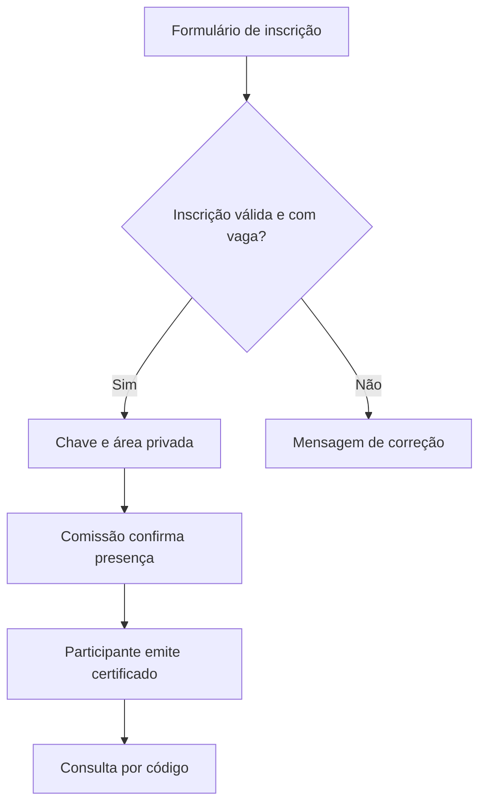
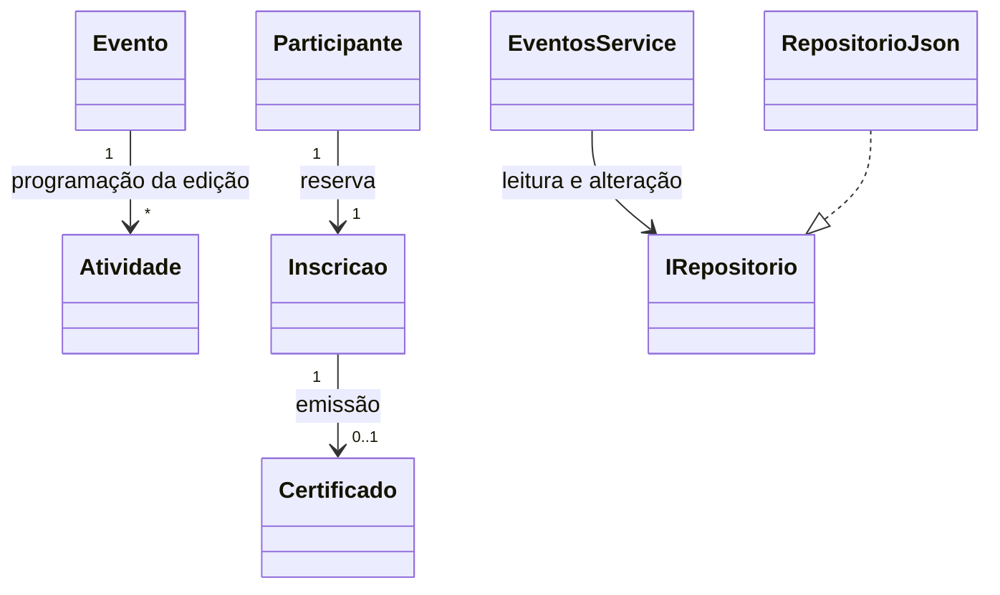

# Desenvolvimento web e modelagem orientada a objetos

O protótipo realiza o ciclo de um evento acadêmico. A comissão altera dados da edição, mantém a agenda, registra presença, publica avisos e responde mensagens. A interface HTML5 é renderizada por views Razor. Controllers C# recebem formulários, controlam o acesso e delegam regras ao serviço de eventos. CSS3 usa Grid, Flexbox e media queries de 53 e 40 rem, com reflow testado desde 320 px. Os detalhes e resultados constam no relatório acadêmico e nas evidências.

| Requisito | Interface | Critério de verificação |
| --- | --- | --- |
| RF1 Apresentar a edição | Início | Exibe período, destaques e avisos do estado inicial |
| RF2 Consultar e manter agenda | Programação e Gestão | Ordena por início, filtra tipo, permite editar ou cancelar e publicar link HTTPS |
| RF3 Inscrever e autenticar | Inscrição e Área do participante | Valida campos e capacidade, rejeita e-mail duplicado e usa chave com cookie |
| RF4 Atender e comunicar | Área do participante, Gestão e Avisos | Mensagem privada, resposta privada e comunicado público |
| RF5 Registrar presença e certificar | Gestão, Área do participante, Certificados | Presença habilita emissão, repetição retorna o mesmo certificado, código verifica o documento |
| RF6 Dar apoio em Libras | Libras | Três storyboards, glossário contextual e referência visual do INES |
| RNF1 Responsividade e teclado | Todas as páginas | Sem rolagem horizontal a 320 px, foco visível e navegação por teclado |
| RNF2 Persistência e rastreabilidade | Serviço | Registros sobrevivem à reabertura do arquivo e mutações geram entradas de auditoria |
| RNF3 Acesso por papel | Controllers | Participante vê os próprios dados, ações de gestão exigem cookie de administrador, POST exige token |

## Casos de uso

| Caso | Ator e pré-condição | Resultado esperado | Exceção |
| --- | --- | --- | --- |
| UC1 Consultar programação | Visitante | Agenda agrupada por data e filtro aplicado | Filtro vazio exibe todas as atividades |
| UC2 Reservar vaga | Visitante, inscrição aberta | Nova inscrição, sessão ativa e chave de acesso | Capacidade, duplicidade e entrada inválida geram mensagem |
| UC3 Pedir apoio | Participante autenticado | Mensagem visível ao remetente e à comissão | Texto curto ou acima do limite é recusado |
| UC4 Confirmar presença | Comissão, inscrição existente | Presença marcada e auditoria registrada | Identificador desconhecido é recusado |
| UC5 Emitir e verificar certificado | Participante com presença e agenda ativa | Certificado imprimível e código de consulta | A emissão fica indisponível sem presença ou carga horária |
| UC6 Alterar agenda e comunicar | Comissão autenticada | Agenda atualizada e aviso publicado em ação própria | Dados inválidos geram mensagem |
| UC7 Consultar apoio | Visitante | Roteiros de Libras, glossário e acesso ao atendimento | Atendimento individual requer inscrição |

## Modelo de domínio

A associação entre evento e coleções é estabelecida por `Estado`, que agrega a edição única. `Inscricao` encapsula `Presente` por acessor privado. `Evento.Configurar` aplica a capacidade e `Atividade.Criar` valida duração e endereço HTTPS. `UsuarioAdministrador` representa a comissão e verifica a senha configurada no ambiente. `List<T>` mantém as coleções em memória durante cada operação. `Where`, `OrderBy` e `Join` implementam filtragem de atividades, ordenação e busca de inscritos.

O repositório usa trava compartilhada pelas requisições do mesmo processo. Uma alteração carrega, valida, serializa para arquivo temporário no mesmo diretório, faz flush e substitui o destino. Um arquivo corrompido gera log e a operação é recusada. A condição de presença é verificada com o estado corrente. O certificado emitido carrega instante, participante, período e duração da agenda ativa daquele momento.

## Decisões de acesso e layout

- Cabeçalho, navegação, conteúdo principal e rodapé semânticos, um título principal por página e rótulos ligados aos campos.
- Atalho para conteúdo, foco evidente, ações por teclado, mensagens textuais e indicação explícita de cancelamento.
- Formulários com validação de servidor, proteção antifalsificação e cookies com duração de duas horas. O código de autenticação do participante tem 128 bits aleatórios e armazenamento em hash.
- HTML de certificado com estilo de impressão. A consulta pública apresenta nome e dados do certificado mediante seu código. O cadastro mantém e-mail e mensagens, portanto devem ser usados dados fictícios em avaliação.
- Uma instância por arquivo. Publicação para uso real exigiria HTTPS, políticas de recuperação de acesso, retenção de dados e validação com pessoas usuárias.
